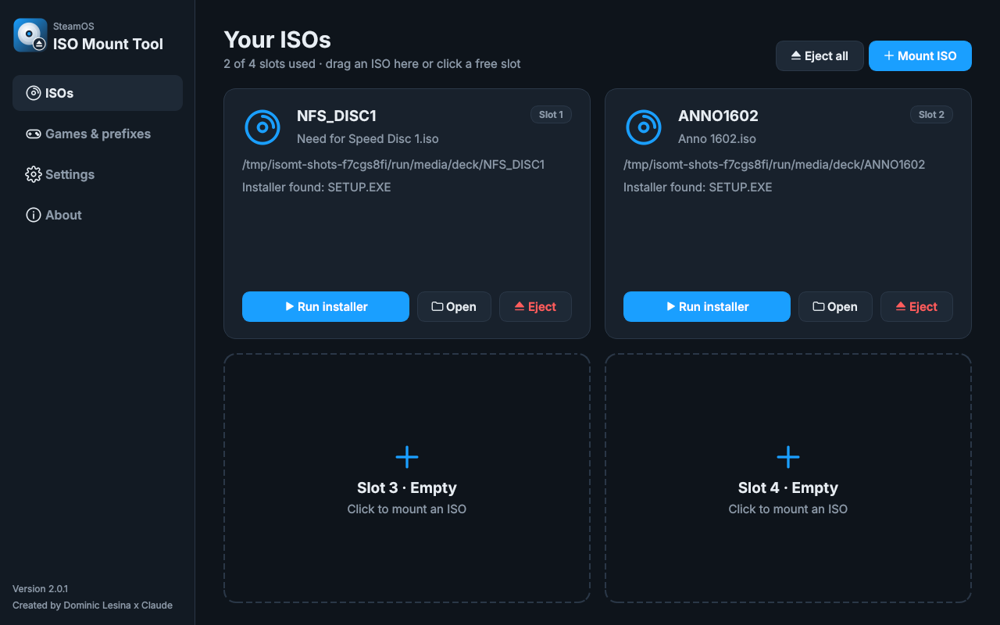
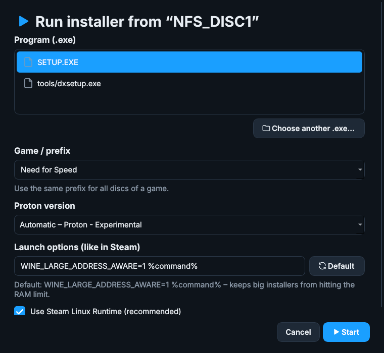

<p align="center">
  
</p>

<h1 align="center">SteamOS ISO Mount Tool</h1>

<p align="center">
  Mount up to <b>4 ISO images</b> on SteamOS and run their Windows installers <b>directly with Proton</b> – no sudo, no terminal, no adding <code>setup.exe</code> to Steam by hand.<br>
  Also available for <b>Windows 10/11</b>.<br>
  <i>Created by Dominic Lesina x Claude</i>
</p>

<p align="center">
  
</p>

---

## Features

- 💿 **Mount & eject ISOs** – up to 4 at the same time, via button, click on a free slot or **drag & drop**
- 🎮 **Run installers with Proton** – one click on **Run installer** starts `setup.exe` (or the `autorun.inf` target) from the ISO with Proton
- 🚀 **Newest Proton automatically** – Proton Experimental if installed, otherwise the highest version (official or GE-Proton). Any installed version can be picked
- 🧠 **No more RAM-limit crashes** – launch options work like in Steam, default: `WINE_LARGE_ADDRESS_AWARE=1 %command%`
- 🗂️ **One prefix per game** – stored in `~/Games/IsoMountTool/<game>`
- 💽 **Multiple discs** – when the installer asks for disc 2, eject disc 1 and mount disc 2 (it is reachable under `Z:\run\media\…`). Optional, experimental: slots 1–4 as drives **D:–G:** inside the prefix
- ▶️ **Games & prefixes page** – start the installed game, run any program in its prefix, open drive C:, delete a prefix
- 🚀 **Send to LakuenLauncher** – one click adds the installed game to [LakuenLauncher](https://github.com/elkarbeenus/Lakuenlauncher) with the same prefix, Proton and launch options
- 🌐 **German & English**
- 🔄 **Auto update** – checks this repository for new releases on start and asks whether to update or keep the current version; one click downloads, verifies (SHA-256) and replaces the program, settings and games stay (can be turned off, or set `ISOMT_NO_UPDATE=1`)
- 🔐 **No root** – mounting uses `udisksctl`, the same way Dolphin mounts drives
- 📦 **Everything included** – the AppImage bundles its own Python and Qt

## Downloads

| System | File (from the [latest release](https://github.com/elkarbeenus/SteamOS-IsoMountTool/releases/latest)) |
|---|---|
| SteamOS / Linux | `SteamOS-IsoMountTool-x.y.z-x86_64.AppImage` |
| Windows 10 / 11 (64-bit) | `SteamOS-IsoMountTool-x.y.z-windows-x64.exe` |

## Requirements

- **SteamOS:** SteamOS 3.x in **Desktop Mode** (also works on most other Linux desktops). For installers: Steam with at least one Proton version (e.g. *Proton Experimental*: Steam → Library → Tools) or GE-Proton (e.g. via ProtonUp-Qt)
- **Windows:** Windows 10 or 11, 64-bit. Nothing else needed

## Installation

### SteamOS / Linux
1. Download the `.AppImage` from the [Releases page](https://github.com/elkarbeenus/SteamOS-IsoMountTool/releases/latest).
2. Move it to a folder in your home directory, e.g. `~/Applications` (needed for the auto update).
3. Right-click → **Properties** → **Permissions** → tick **Is executable**.
4. Double-click it to start.

### Windows
1. Download the `.exe` from the [Releases page](https://github.com/elkarbeenus/SteamOS-IsoMountTool/releases/latest) and put it in a folder you can write to (e.g. your *Documents* or a *Tools* folder – needed for the auto update).
2. Double-click it. No installation needed.
3. Windows SmartScreen may warn because the file is not signed: **More info** → **Run anyway**.

## Installing a game from an ISO

<p align="center"></p>

1. **Mount** the ISO (click a free slot or drag the `.iso` onto the window).
2. Click **Run installer** on the slot.
3. Check the dialog:
   - **Program** – the installer the tool found (or choose another `.exe`)
   - **Game / prefix** – the name of the game. Use the same name for every disc of a game
   - **Proton version** – *Automatic* uses the newest one
   - **Launch options** – `WINE_LARGE_ADDRESS_AWARE=1 %command%` by default, same syntax as in Steam
4. Click **Start** and install the game as usual (to `C:\` inside the prefix).
5. **Multiple discs?** When the installer asks for the next disc: eject the ISO in the tool, mount the next one and point the installer to it (`Z:\run\media\<user>\<disc>`). If an installer insists on a CD drive, turn on *ISOs as drives D:–G:* in the settings (experimental).
6. Afterwards, open **Games & prefixes** → **Run program…** and choose the game's `.exe` once. From then on **Play** starts it.
7. Optional: click **Send to LakuenLauncher** – the game appears in the launcher's library with the same prefix, Proton version and launch options. (Close LakuenLauncher before clicking; the tool tells you if it's still running.)

Logs of every run are stored in `~/.local/share/steamos-isomounttool/logs/`.

## Windows version

The Windows version has the same interface with a few differences:

- ISOs are mounted with Windows' built-in ISO support (like right-click → *Mount*); every ISO gets its real drive letter.
- **Run installer** starts the installer directly – no Proton needed. If it needs administrator rights, Windows asks (UAC).
- The **Games** page lists the games you installed: choose the game's `.exe` once (**Choose game .exe…**), then start it with **Play**. *Remove* only removes the entry – the installed game is not touched.
- Settings: `%APPDATA%\steamos-isomounttool`, logs: `%LOCALAPPDATA%\steamos-isomounttool\logs`

## Command line

```bash
./SteamOS-IsoMountTool.AppImage --mount ~/Downloads/game.iso   # mount
./SteamOS-IsoMountTool.AppImage --list                         # list mounted ISOs (slot, drive, path)
./SteamOS-IsoMountTool.AppImage --eject ~/Downloads/game.iso   # eject (ISO path or /dev/loopN)
./SteamOS-IsoMountTool.AppImage --eject-all                    # eject all
./SteamOS-IsoMountTool.AppImage --list-proton                  # Proton versions found
./SteamOS-IsoMountTool.AppImage --check-update                 # check for updates
./SteamOS-IsoMountTool.AppImage --lang en                      # set language (de|en)
./SteamOS-IsoMountTool.AppImage --no-update-check              # skip the update check on start
```

## How it works

- **Mounting:** `udisksctl loop-setup --read-only` + `udisksctl mount`. Mounted ISOs are found through the loop devices, so ISOs mounted another way count toward the limit of 4 too.
- **Proton:** Proton is started the way Steam starts a non-Steam game: `STEAM_COMPAT_DATA_PATH` points to the game's prefix, the `.exe` is passed with its Linux path, the working directory is the folder of the `.exe`, and Proton runs inside the Steam Linux Runtime it asks for (`_v2-entry-point`). Your launch options are applied like in Steam (`VAR=value … %command% args`).
- **Drive letters (experimental, off by default):** `~/.local/share/steamos-isomounttool/drives/d…g` point to the ISO in slot 1–4, and the prefix links `D:`–`G:` there as CD-ROM drives.

Settings: `~/.config/steamos-isomounttool/config.json`

## Troubleshooting

- **“Could not eject … still in use”** – close the installer or Dolphin windows that still use files from the ISO.
- **The installer does not start** – open the log (button in the app). Try another Proton version, or turn off *Steam Linux Runtime* in the settings.
- **No Proton found** – install *Proton Experimental* in Steam (Library → Tools) or GE-Proton, then click **Rescan** in the settings.
- **The update check fails** – you are offline or GitHub can't be reached; the tool still works.

## Building from source

```bash
git clone https://github.com/elkarbeenus/SteamOS-IsoMountTool.git
cd SteamOS-IsoMountTool
python3 -m unittest discover -s tests   # core tests (incl. simulated Windows logic)
./build.sh                              # → dist/SteamOS-IsoMountTool-<version>-x86_64.AppImage (needs internet)
```

The Windows `.exe` is built with PyInstaller by GitHub Actions (job `windows` in `.github/workflows/release.yml`).

## Releasing (maintainers)

1. Bump the version in `VERSION` and add a new section to `CHANGELOG.md` (`## [x.y.z] – date`).
2. Commit and push to `main`.
3. GitHub Actions runs the tests, builds the AppImage and the Windows `.exe` and, if there is no release for that version yet, creates the tag `vx.y.z` and publishes the release with both files, using that version's CHANGELOG section as release notes. Installed copies pick the update up through the auto update.

## Credits

**Created by Dominic Lesina x Claude**
